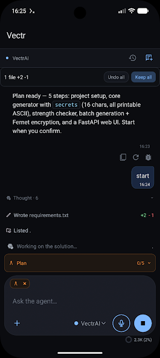
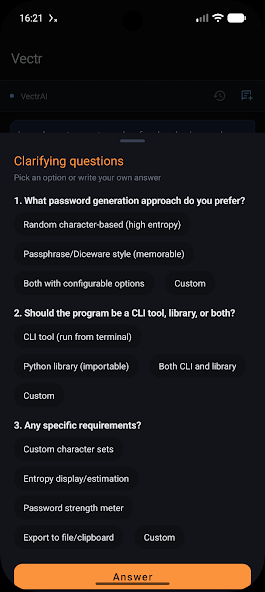
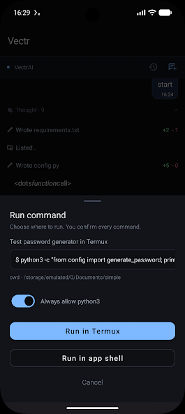

# Vectr AI IDE

**Vectr AI IDE** - ваш карманный ИИ-агент в телефоне. Может выполнять много разных задач, начиная от создания файлов, заканчивая управлением вашим смартфоном и компиляцией проектов (Python, Java, Node.js, и т.д.).

## Что под капотом
- Локальная разработка и правка Android/Java-проектов.
- ИИ-агент (Свой API-ключ или встроенный ИИ).
- Интеграция с Termux.
- Синхронизация с ПК по локалке через Vectr Sync.
- Режим дизайна и планирования
- Скиллы
- Предоставьте агенту исправить ошибку в телефоне самому

## Скриншоты

